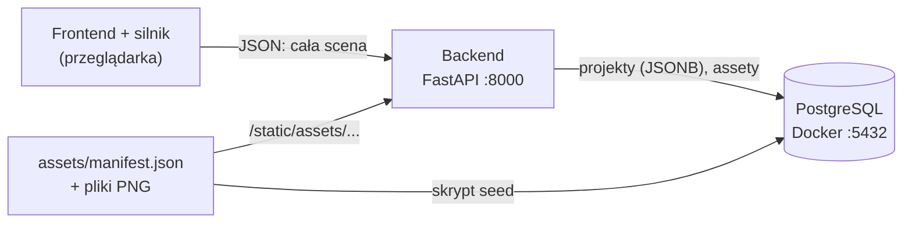

# Architektura backendu

Backend (Python 3.12, FastAPI) przechowuje projekty map i postaci, sprawdza poprawność scen i udostępnia bibliotekę assetów.
Edycję sceny liczy silnik w przeglądarce; backend dostaje gotową scenę w całości, sprawdza ją (także kolizje) i zapisuje bez zmian
(nadaje tylko `id` i daty). Uruchomienie: `backend/README.md`, endpointy: [API.md](API.md), błędy: [ERRORS.md](ERRORS.md).



## Struktura `backend/`

```
src/
  main.py            tworzy aplikację: middleware, routery, serwowanie PNG
  config.py          ustawienia z env (Settings) i stałe reguł: limity, rozmiary
  errors.py          kody błędów → klucze tłumaczeń (MESSAGE_KEYS), Issue, AppError
  error_handlers.py  zamienia każdy wyjątek na odpowiedź {"error": ...}
  body_limit.py      odrzuca ciało zapytania większe niż 3 MB
  ports.py           interfejsy repozytoriów (AssetRepository, ProjectRepository)
  deps.py            wybór implementacji repozytoriów i wstrzykiwanie ich do endpointów
  db_repos.py        repozytoria w bazie: zamieniają modele bazy na modele kontraktu
  api/               endpointy (cienkie: odczyt zapytania → serwis → odpowiedź)
  schemas/           modele Pydantic kontraktu: Scene, Layer, SceneObject, Asset, ProjectSummary
  services/          logika: validation.py (reguły sceny), geometry.py (narożniki i test SAT dla kolizji),
                     projects.py (id, daty, zapis), import_export.py
  dev/               repozytoria w pamięci (testy i praca bez bazy)
  db/                warstwa bazy: modele tabel, zapytania, seed (opis w src/db/README.md)
migrations/          migracje Alembic (schemat tabel)
tests/               testy pytest
```

## Droga zapytania

Na przykładzie `PUT /api/projects/{id}`:

1. **Middleware** (od zewnątrz): CORS dopisuje nagłówki → `body_limit.py` odrzuca za duże ciało (`413`) →
   `error_handlers.py` zamienia nieobsłużony wyjątek na `500 SERVER_ERROR`.
2. **Endpoint** (`api/projects.py`): FastAPI czyta JSON i buduje z niego model `Scene`; zły kształt danych kończy się
   `422` z problemami `INVALID_FIELD`, zanim endpoint w ogóle zadziała.
3. **Serwis** (`services/projects.py`): pobiera zapisany projekt (`404`, gdy go nie ma), odrzuca zmianę `type`,
   wywołuje `check_scene` i przy problemach zgłasza `AppError("VALIDATION_FAILED", 422, issues)`.
4. **Repozytorium**: serwis ustawia `id`, `createdAt` i `updatedAt` i zapisuje scenę przez `ProjectRepository.save_project`.
5. **Błędy**: każdy `AppError` i błąd FastAPI zamienia na odpowiedź `{"error": {"code", "messageKey", "details"}}`
   handler z `error_handlers.py`.

Endpointy nie zawierają logiki: odczytują zapytanie, wołają funkcję z `services/` i zwracają wynik.
Serwisy nie wiedzą nic o HTTP poza kodem statusu w `AppError`, a reguły sceny (`check_scene`) nie wiedzą nawet tego.

## Poziomy walidacji

| Poziom | Gdzie | Błąd |
|---|---|---|
| 1. rozmiar i składnia | `body_limit.py`, parser JSON | `413 INVALID_FILE`, `422` z `INVALID_FIELD` |
| 2. kształt i typy pól | modele w `schemas/` (ścisłe typy, nieznane pole to błąd, bez `NaN`) | `422` z `INVALID_FIELD` i `field` |
| 3. reguły sceny | `check_scene` w `services/validation.py` | `422` z kodami reguł, wszystkie naraz |
| 4. zapis | repozytorium | `500 SERVER_ERROR`, np. gdy baza nie działa |

Import pliku przechodzi te same poziomy, tyle że poziomy 1–2 sprawdza `parse_import_file` (`services/import_export.py`)
i zgłasza je jako `INVALID_FILE` (`400` albo `413`).

`check_scene(scene, assets)` to czysta funkcja: dostaje gotową scenę i słownik `id → Asset`, zwraca listę problemów,
nie korzysta z bazy ani z HTTP. Dzięki temu każdą regułę testuje się bez serwera.

Silnik (`engine/src/validation/`) sprawdza w przeglądarce te same reguły, także kolizje; backend liczy je tymi samymi
wzorami (`services/geometry.py`, odpowiednik `engine/src/geometry/`). Backend nie ufa jednak
frontendowi: plik importu albo zapytanie spoza edytora też musi przejść reguły.

## Repozytoria i baza

Kod API korzysta z danych wyłącznie przez interfejsy z `ports.py`. Są dwie implementacje:

| Implementacja | Plik | Kiedy |
|---|---|---|
| w bazie | `db_repos.py` (zapytania w `src/db/repositories/`) | serwer uruchomiony przez Uvicorn |
| w pamięci | `dev/memory_repos.py` (assety z manifestu) | testy endpointów (`Settings` bez `database_url`) |

Wybór jest w jednym miejscu, `deps.py`, przy starcie aplikacji (`create_app` w `main.py`). Endpoint dostaje repozytorium
przez `Depends(get_project_repository)` i nie wie, która implementacja działa.

Scena trafia do tabeli `projects` w całości jako jeden dokument JSONB. Assety ładuje do tabel `asset_categories`
i `assets` skrypt `python -m src.db.seed` z `assets/manifest.json`, a pliki PNG są serwowane prosto z folderu `assets/`.
Szczegóły tabel i migracji: `backend/src/db/README.md`.

## Konfiguracja

- Zmienne środowiskowe (plik `backend/.env`, wzór w `.env.example`): `CLIENT_ORIGIN` (adresy frontendu dla CORS)
  i `DATABASE_URL` (adres bazy). Czyta je `load_settings` w `config.py`.
- Stałe reguł (wersja schematu, limit warstw, rozmiary płótna, zakresy skali i obrotu, limit 3 MB) są w `config.py`.
  Zmiana limitu to zmiana jednej stałej, bez ruszania `check_scene`.

## Testy

```
cd backend
pytest
```

- Reguły sceny (`test_validation.py`) i geometria kolizji (`test_geometry.py`): na samych modelach, bez serwera.
- Endpointy (`test_projects.py`, `test_io.py`, `test_assets.py`, ...): `TestClient` na aplikacji z repozytoriami w pamięci,
  każdy test ze świeżą aplikacją.
- Baza (`test_db.py`, `test_db_repos.py`, `test_*_repository.py`, `test_migrations.py`, `test_seed.py`): osobne bazy
  `*_test…` w kontenerze z `docker compose`, więc baza deweloperska zostaje nietknięta; bez działającego Dockera są pomijane.
- Wspólne dane testowe (np. poprawna scena `scene_data`) są w `tests/conftest.py`.

CI (`.github/workflows/backend.yml`) uruchamia `pytest` przy każdym PR zmieniającym `backend/`.

## Nowa reguła walidacji

Przykład: każda warstwa musi mieć niepustą nazwę (kod `LAYER_NAME_REQUIRED`).

**1. Kod i klucz** w `MESSAGE_KEYS` (`src/errors.py`), w grupie reguł sceny. Kod w stylu `UPPER_SNAKE`, klucz
`errors.camelCase` (pilnuje tego test `test_message_keys_follow_naming_convention`):

```python
    "LAYER_NAME_REQUIRED": "errors.layerNameRequired",
```

**2. Sprawdzenie** w `src/services/validation.py`: nowa funkcja, która zwraca listę problemów, i jej wywołanie
w `check_scene`. Miejsce wywołania ustala kolejność problemów w odpowiedzi. Problem dotyczący warstwy lub obiektu
podaje `layerId` (i `objectId`), żeby frontend mógł wskazać element. Liczbowy limit trafia jako stała do `config.py`.

```python
def check_scene(scene: Scene, assets: Mapping[str, Asset]) -> list[Issue]:
    ...
    issues += check_scene_fields(scene)
    issues += check_layer_names(scene)
    issues += check_unique_ids(scene)
    ...


def check_layer_names(scene: Scene) -> list[Issue]:
    """Sprawdza, czy każda warstwa ma nazwę; nazwa z samych spacji liczy się jako pusta."""
    issues: list[Issue] = []
    for layer in scene.layers:
        if not layer.name.strip():
            issues.append(Issue.of("LAYER_NAME_REQUIRED", layerId=layer.id))
    return issues
```

**3. Test** w `tests/test_validation.py`: przypadek poprawny i błędny, przy limitach liczbowych także wartości
na samej granicy. Fixture `scene_data` daje poprawną scenę z warstwą `l1`:

```python
@pytest.mark.parametrize("name", ["", "   "])
def test_layer_without_name_is_rejected(scene_data, name):
    scene_data["layers"][0]["name"] = name

    assert issue_dicts(scene_data) == [
        {"code": "LAYER_NAME_REQUIRED", "messageKey": "errors.layerNameRequired", "layerId": "l1"}
    ]
```

**4. Uruchomienie** `pytest`. Endpointów nie trzeba zmieniać: `POST`, `PUT` i import wołają `check_scene` same.

**5. Poza backendem:**
- tłumaczenia `pl` i `en` nowego klucza w `frontend/src/i18n/dictionary.ts`; bez nich frontend pokaże ogólny błąd serwera,
- wiersz w tabeli „Kody problemów” w [ERRORS.md](ERRORS.md),
- ta sama reguła w silniku (`engine/src/validation/`), żeby edytor nie pozwalał zbudować sceny, którą backend odrzuci.
